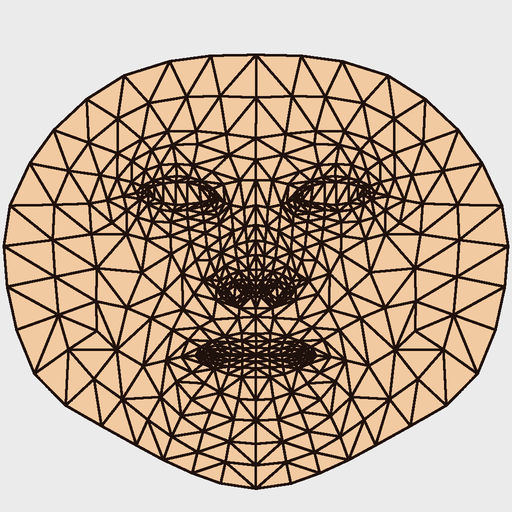
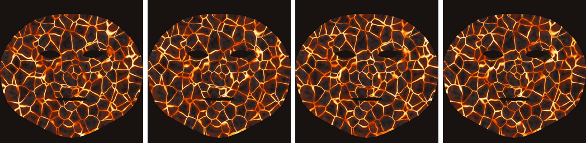
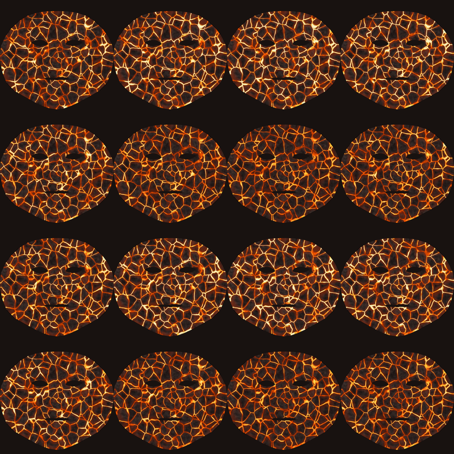
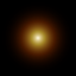

# Máscara de Lava AR 🌋

Filtro facial web para celular: al abrir la página se activa la cámara frontal y tu cara se
convierte en **roca volcánica con grietas de lava** que fluyen y laten, rodeada de una
**corona de flamas**. La máscara sigue tus movimientos y reacciona a tus gestos:
al **abrir la boca** haces erupción.

> Actividad 2 del curso de Realidad Virtual y Aumentada: "Filtro facial interactivo con
> máscara animada reactiva a gestos".

**Pruébalo:** _ENLACE_DE_CLOUDFLARE_ (ábrelo desde el celular; la cámara necesita HTTPS)

<!-- Capturas: guarda tus imágenes en docs/screenshots/ y descomenta estas líneas.


-->

---

## Cómo se usa

1. Abre el enlace en el celular y permite el acceso a la cámara. El filtro arranca solo.
2. Muestra tu cara: la máscara de lava y las flamas se colocan encima.
3. Toca la pantalla (o el botón 🔇/🔊) para activar el sonido.

| Gesto | Efecto |
|---|---|
| **Abrir la boca** | **Erupción:** las grietas se encienden al máximo, salen brasas de la boca, las flamas crecen, destello naranja en los bordes y rugido de fuego. |
| **Levantar las cejas** | **Calor:** la lava pasa de naranja a amarillo-blanco por un momento, con un siseo. |

Cada gesto se dispara una sola vez al cruzar su umbral, con una pausa (1 s la boca,
1.5 s las cejas) para que no se repita.

**Modos para desarrollo** (se agregan a la URL):

- `?debug=1`: puntos de los landmarks, fps y valores de `jawOpen` / `browInnerUp` en vivo
  con su umbral (sirve para calibrar). Las teclas **E** y **H** disparan la erupción y el
  calor sin hacer el gesto.
- `?template=1`: muestra la plantilla UV en lugar de la lava, para revisar la alineación.

---

## Herramientas

- **[MediaPipe Face Landmarker](https://ai.google.dev/edge/mediapipe/solutions/vision/face_landmarker)**:
  478 landmarks y blendshapes (gestos) en el navegador, con GPU y respaldo a CPU.
- **[three.js](https://threejs.org/)**: malla facial con la textura animada (shader propio),
  flamas y partículas.
- **Web Audio API**: sonidos (sintetizados en el propio código).
- **[Blender 4.x](https://www.blender.org/)** con scripts de Python: genera la textura de lava.
- **Claude Code**: los scripts y el código se escribieron junto con Claude Code; el concepto
  y la dirección de diseño son del equipo.

HTML + CSS + JavaScript (módulos ES) sin frameworks ni paso de build.

---

## Proceso de la textura

La lava no es una foto ni un video: es un **material procedural de Blender horneado (bake)
directamente sobre la UV de la malla facial de MediaPipe**, así que respeta los rasgos de la
cara y no tiene costuras.

### 1. Plantilla UV — `blender/01_uv_template.py`

Se importa la malla canónica de MediaPipe (468 vértices, 898 triángulos) y se exporta su
mapa UV. Sirve para alinear la máscara con la cara (`?template=1`) y como referencia para
diseñar.



### 2. Material procedural y bake — `blender/02_lava_frames.py`

- **Grietas:** Voronoi (distancia a borde) deformado con ruido, con ancho variable.
  Alrededor de **ojos, frente y pómulos** hay una segunda red de grietas más fina y más brillo.
- **Roca:** Noise oscuro (`#1a1414` – `#3a2e2a`), placas con tono propio y bordes chamuscados.
- **Lava:** ColorRamp + Emission: rojo profundo → naranja `#ff5a00` → amarillo `#ffd23f` →
  casi blanco en el núcleo.
- **Animación:** el ruido que recorre las grietas se desplaza en un círculo (seno y coseno de
  la fase) y el brillo late con `sin(2·fase)`, así que el **cuadro 16 empata con el 1**:
  el loop no salta.
- **Bake:** Cycles hornea la emisión de cada cuadro a la UV. Después se aplica
  **alfa = 0 en ojos y boca** a partir de los contornos de MediaPipe.

Resultado: 16 cuadros de 512×512. Aquí van 4 de ellos:



### 3. Sprite sheet — `blender/03_build_sheet.py`

Los 16 cuadros se unen en una cuadrícula de 4×4 (2048×2048, PNG con transparencia, 3.9 MB).
En el filtro, un shader avanza los cuadros a 8 fps y funde cada uno con el siguiente para que
el flujo se vea suave.



### 4. Brasa — `blender/04_ember.py`

Sprite de 64×64 para las partículas de la erupción.



Las **flamas** alrededor de la cara no usan textura: se generan en tiempo real con un shader
de ruido sobre un anillo que sigue el contorno del rostro.

---

## Instalación y ejecución local

No hay dependencias que instalar para el filtro. Solo hace falta servir la carpeta:

```bash
python -m http.server 8000
```

Abre `http://localhost:8000` (en `localhost` la cámara funciona sin HTTPS). Para probar en
el celular necesitas HTTPS: usa el enlace publicado o despliega tu propia copia.

### Publicar en Cloudflare

El proyecto está configurado como sitio estático de Cloudflare Workers (`wrangler.jsonc`);
`.assetsignore` deja fuera los scripts de Blender, la documentación y los archivos internos.

```bash
npx wrangler login
npx wrangler deploy
```

### Regenerar la textura con Blender

Requisitos: Blender 4.x y Python 3 con Pillow y numpy (`pip install pillow numpy`).
Si `blender` no está en el PATH, usa la ruta completa del ejecutable
(Windows: `"C:\Program Files\Blender Foundation\Blender 4.3\blender.exe"`,
Mac: `/Applications/Blender.app/Contents/MacOS/Blender`).

```bash
blender --background --factory-startup --python blender/01_uv_template.py   # plantilla UV
blender --background --factory-startup --python blender/02_lava_frames.py   # 16 cuadros (~2 min)
python blender/03_build_sheet.py                                            # sprite sheet
python blender/04_ember.py                                                  # brasa
```

El diseño se ajusta con las constantes al inicio de `02_lava_frames.py` (`COLORS`,
`CRACK_SCALE`, `CRACK_WIDTH`, `FLOW_CONTRAST`, `PULSE`, `HOT_SPOTS`…).

### Ajustes del filtro

Todo lo ajustable vive en [`js/config.js`](js/config.js): umbrales y pausas de los gestos,
intensidad de la erupción y las brasas, flamas (`FLAMES`), volúmenes y archivos de sonido
opcionales (`SOUNDS`). Para la Actividad 3 basta con cambiar `config.js`, la textura y
`js/effects.js`.

---

## Estructura

```
index.html, css/style.css
js/
  main.js       arranque: cámara, MediaPipe, render loop, UI y modo debug
  config.js     todas las constantes ajustables
  face.js       MediaPipe: landmarks y blendshapes (GPU con respaldo a CPU)
  scene.js      cámara ortográfica alineada al video (espejo + object-fit: cover)
  mask.js       malla facial + shader de la sprite sheet animada
  flames.js     corona de flamas procedural
  gestures.js   gestos con umbral, pausa e histéresis
  effects.js    erupción (brillo, brasas, destello) y calor
  audio.js      sonidos (archivos opcionales o sintetizados)
assets/         malla canónica, plantilla UV, sprite sheet, brasa
blender/        scripts de la textura (output/ = cuadros intermedios)
docs/           imágenes del README
```

---

## Créditos y licencias

| Recurso | Fuente | Licencia |
|---|---|---|
| Malla canónica (`canonical_face_model.obj`) y modelo Face Landmarker | [MediaPipe](https://github.com/google-ai-edge/mediapipe) (Google) | Apache 2.0 |
| three.js | [threejs.org](https://threejs.org/) | MIT |
| Ruido de valor 3D del shader de flamas | Técnica de [Inigo Quilez](https://iquilezles.org/articles/morenoise/) | MIT |
| Textura de lava, brasa y flamas | Propias (Blender + shaders) | Propia |
| Sonidos | Sintetizados con Web Audio en `js/audio.js` | Propios |

---

## Autor

_NOMBRE(S) DEL EQUIPO_
